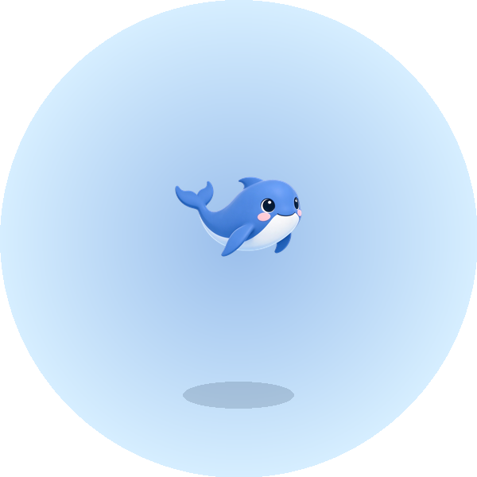

# dsh-codex-pets



DSH Desktop 的 macOS 桌面宠物：一只 DeepSeek 小鲸鱼浮在所有窗口之上，点一下唤起 DSH，拖着换位置，闲着会自己动。

## 功能

- **常驻桌面**：透明无边框、始终置顶、跟随所有桌面，不抢焦点。
- **点击回 DSH**：点宠物把 DSH 窗口带到前面；没在运行就打开它。
- **拖动跟手**：窗口按屏幕刷新率跟随光标，位置记住，下次启动还在原处。
- **自己会动**：闲时轮流演小动作，偶尔来一次带粒子的表演；系统开了「减少动态效果」时只显示静态帧。
- **可换可调**：设置 → 宠物里挑宠物、拉大小（120–260 px），即时生效，不用重启 DSH。
- **可开可关**：设置里关掉「显示宠物」，或者在宠物上右键选「隐藏宠物」，鲸鱼就从桌面上收起来，再打开时回到原来的位置。
- **更多宠物**：兼容 Codex 的宠物格式，可以从 [codex-pets.net](https://codex-pets.net) 装，也可以从本机 Codex 一键导入。
- **最近会话球**（默认开启）：宠物脚下显示会话数，点开就能跳到你正在等的那个会话。

## 安装

需要 macOS 13+ 和 DSH Desktop 0.2.1+。

直接从 GitHub 装，插件的依赖由 profile 的 pnpm 一起装好：

```sh
dsh plugin --profile desktop add github:jusong/dsh-codex-pets
```

要固定版本就带上 tag，例如 `github:jusong/dsh-codex-pets#v0.8.0`。

要改代码就用本地目录。这时 DSH 只建一个 `link:`，不会替这个 checkout 装依赖，得自己先装一次：

```sh
npm install        # 或 pnpm install
dsh plugin --profile desktop add ./dsh-codex-pets
```

装完重启 DSH，鲸鱼会出现在屏幕右下、输入框上方。

如果没出现，在 `~/.dsh/profiles/desktop/cordis.patch.yml` 里手动加上这段，让 loader 加载它：

```yaml
- id: dsh-codex-pets
  name: dsh-codex-pets
  config:
    pet: deepseek-whale
```

## 使用

**设置 → 宠物**（也挂在「插件 → 内置插件配置 → 桌面宠物」下）：

- 顶部的「显示宠物」开关控制它是否留在桌面上；在宠物上右键也有「隐藏宠物」；
- 点画廊里的卡片切换宠物，上方的预览和尺寸滑块跟着变；
- 在输入框里粘 codex-pets.net 的宠物 ID 或页面链接即可安装，装完排到「已安装」末尾；
- 「从 Codex 导入」会把 `~/.codex/pets` 里还没导入的、以及 Codex 自带（打在 `ChatGPT.app` 里）的宠物一起装进来；
- 用户装的宠物可以删除、拖拽排序；内置那只不能删。删掉正在用的那只时会自动切到剩下的第一只（至少要保留一只）。

## 配置

```yaml
- id: dsh-codex-pets
  name: dsh-codex-pets
  config:
    pet: deepseek-whale   # pets/<id> 的目录名
    size: 220             # 120–260 px
    visible: true         # false 隐藏宠物（右键宠物也能隐藏）
    sessions: true        # 脚下的最近会话球
    sessionLimit: 5       # 球里列几条（1–10）
    sessionMotion: true   # 有会话在忙时宠物不闲着，忙完跳一下
```

用户装的宠物放在 `~/.dsh/dsh-codex-pets/`，顺序记在同目录的 `pets.json`。旧版用的是 `~/.dsh/pets`，升级后首次启动会自动搬过去。

## 宠物

内置一只 `deepseek-whale`（v1 图集，8 列 × 9 行）。宠物就是一份 `pet.json` 加一张精灵图集，格式和 Codex 的完全一致。

- 想用现成的：在设置页安装，或者 `node tools/install-pet.mjs <id | 链接 | zip | 目录>`；
- 想做自己的：把图集和 manifest 放进 `~/.dsh/dsh-codex-pets/<id>/`；手上已有 Codex 宠物的话，`python3 tools/port_custom_pet.py` 能直接转过来。

## 原生助手与 `bin/`

悬浮窗不可能用纯 JS 做：透明、置顶、跨 Space、原生拖动都在 `native/main.swift` 编出的 AppKit `NSPanel` 里，`lib/index.js` 只负责把它 `spawn` 起来。所以 `bin/dsh-codex-pets-macos` 是**编译产物，也是随包发布的运行文件**，必须提交进仓库：

- 安装过程不编译任何东西——`package.json` 没有 `scripts`，`dsh plugin add` 只是拉包、装依赖；
- 换成安装时现场编译也不合适：pnpm 11 默认拦依赖的构建脚本（要用户手动批准），还要求装 Xcode Command Line Tools；
- 少了它，用户看到的就是「插件装好了但桌面上没有宠物」，宿主只会在日志里留一句 `native helper missing`。

它同时包含 **arm64 和 x86_64**（`lipo -info` 能看到两片），macOS 13+ 都能跑；ad-hoc 签名，适合本机使用。仓库里把它当产物看，真正的源只有 `native/main.swift`，要重建就：

```sh
swiftc -O -swift-version 5 -target arm64-apple-macosx13.0 \
  -framework AppKit -framework QuartzCore native/main.swift -o /tmp/dsh-codex-pets-arm64
swiftc -O -swift-version 5 -target x86_64-apple-macosx13.0 \
  -framework AppKit -framework QuartzCore native/main.swift -o /tmp/dsh-codex-pets-x86_64
lipo -create /tmp/dsh-codex-pets-arm64 /tmp/dsh-codex-pets-x86_64 -output bin/dsh-codex-pets-macos
codesign --force --sign - bin/dsh-codex-pets-macos
```

## 开发

```sh
node tools/check-host.mjs           # 宿主路由与画廊
node tools/test-sprite-pet.mjs      # 播放引擎
node tools/test-codex-compat.mjs    # Codex 宠物兼容
node tools/test-pet-management.mjs  # 装 / 删 / 排序 / 导入
node tools/test-session-ball.mjs    # 最近会话球
python3 tools/check_pets.py         # 图集契约
```

不开窗口检查一只宠物画得对不对：`bin/dsh-codex-pets-macos --describe --pet-dir pets/deepseek-whale`。

## 许可

代码和内置宠物（`pets/deepseek-whale`）以 **MIT** 许可证发布，见 [LICENSE](LICENSE)。

Codex 官方那 9 只宠物是 OpenAI 的第一方资产，**不在本仓库中分发**：设置页的「从 Codex 导入」只读本机 `~/.codex/pets` 和 `ChatGPT.app` 里已有的副本，装进你自己的 `~/.dsh/dsh-codex-pets/`，不涉及再分发。从 codex-pets.net 安装的社区宠物各自由其作者授权。
